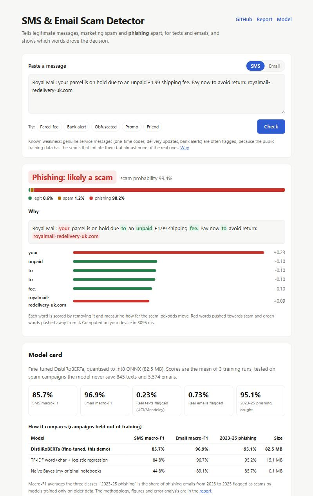
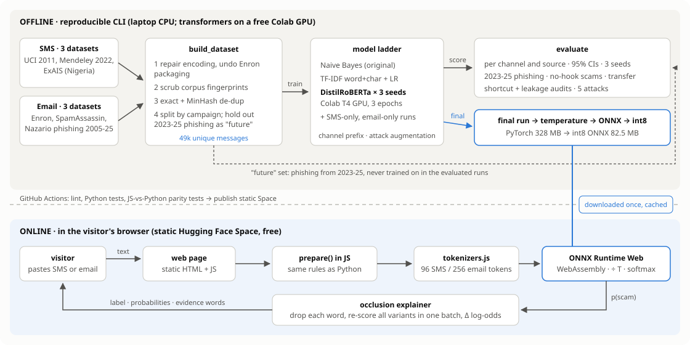

# SMS & Email Scam Detector

[](https://github.com/hamad470/spam-detector/actions/workflows/ci.yml)
[](https://huggingface.co/spaces/hamadurrehman62/spam-detector)
[](https://huggingface.co/hamadurrehman62/scam-detector-distilroberta)


Sorts text messages and emails into **legit**, **spam** (unwanted marketing) or **phishing** (scams, fraud,
credential theft), and shows which words drove each decision. It's a fine-tuned DistilRoBERTa, quantised to
int8 ONNX, that runs **entirely in your browser**: messages you check never leave your device.

**Live demo:** https://huggingface.co/spaces/hamadurrehman62/spam-detector
**Full write-up:** [reports/REPORT.md](reports/REPORT.md) · **Data card:** [data/README.md](data/README.md)



## Results

Test sets contain only spam **campaigns that never appear in training** (see why below). Transformer
numbers are the mean of 3 training seeds.

| | SMS (845 texts) | Email (5,574) |
|---|---:|---:|
| Scams caught (spam + phishing) | **94.8%** | **98.0%** |
| Legitimate messages wrongly flagged | **0.23%** | **0.73%** |
| Scam vs legit F1 | 0.968 | 0.986 |
| 3-class macro-F1 (legit / spam / phishing) | 0.857 ± 0.020 | 0.969 ± 0.004 |
| Phishing emails from **2023-2025**, after the training data ends | | **95.1% caught** |


| Model | SMS macro-F1 | Email macro-F1 | SMS false alarms | 2023-25 phishing caught | Size |
|---|---:|---:|---:|---:|---:|
| **DistilRoBERTa** (fine-tuned, deployed as int8 ONNX) | **0.857** | **0.969** | 0.23% | 95.1% | 82.5 MB |
| TF-IDF word + char n-grams, logistic regression | 0.848 | 0.967 | 0.14% | 95.2% | 15.1 MB |
| Naive Bayes (my original 2024 notebook) | 0.448 | 0.891 | 0.00% | 85.7% | 0.1 MB |

Honest reading: a well-built TF-IDF model is within the confidence interval of the transformer on clean
test data. The transformer earns its place elsewhere: it halves email false alarms (0.73% vs 1.46%), catches
more SMS scams (94.8% vs 90.9%), and still catches 93% of SMS scams when 70% of words carry typos, where
TF-IDF drops to 75%. Most remaining SMS errors are spam vs phishing, a boundary the source labels themselves
blur; telling scams from legitimate texts is the reliable decision.

## What I found

This started as a 2024 Naive Bayes notebook that reported 98% accuracy on one SMS dataset. Extending it to
six datasets and two channels turned it into a study of how easily spam results get inflated.

**1. Dataset fingerprints fool models.** Every email corpus here has a single label: one is all phishing,
the others all legitimate. A model trained on them can pass the usual held-out test while learning *which
corpus an email came from*. Its top phishing clue was `jose@monkey.org`, the inbox the phishing corpus was
collected from. Tested on legitimate email from a source it hadn't seen, it flagged **94.7%** as phishing.
Undoing one dataset's packaging and scrubbing these fingerprints brought that to **15.3%**.


**2. Most of the "new" data was old data, and spam comes in campaigns.** 85% of a 2022 SMS dataset turned
out to be a 2011 one with broken encoding. Half of all spam belongs to near-duplicate campaigns, so a random
split leaks: a naive merge scores F1 0.993 because 78% of its test messages are also in training.
Everything here is split by campaign instead.

**3. Datasets disagree on what spam is.** A Nigerian SMS dataset labels carrier service notices as spam and
some prize-draw promotions as legitimate. Training on it made ordinary service texts look like spam, so it's
kept as a separate external test instead, where it shows how much "spam" depends on who labelled it.

**4. The model holds up on phishing written after its training data, and on disguised text.**


**5. SMS and email barely transfer, and one shared model only works if it's big enough.** The transformer
trained on email alone scores 0.47 macro-F1 on SMS; trained on SMS alone, 0.31 on email. Trained on both, it
matches or beats each specialist. The bag-of-words models go the other way: email's much larger vocabulary
drowns out SMS, costing TF-IDF 4.4 points on SMS and leaving my original Naive Bayes calling almost every
text legitimate.


## Fine-tuned model vs Gemini

The demo page lets you draw random messages and compare three systems on the same 300 held-out validation
messages (150 SMS, 150 email): this model, and `gemini-3.5-flash-lite` prompted two ways (definitions only,
and definitions plus 12 labelled training examples), forced through structured output to answer with exactly
one of legit, spam or phishing at temperature 0.

| On 300 validation messages | Accuracy | Macro-F1 (95% CI) | Scams caught | Legit flagged |
|---|---:|---:|---:|---:|
| **Fine-tuned DistilRoBERTa** (82.5 MB, in the browser) | **93.7%** | **0.931** (0.902-0.959) | 97.2% | **0.8%** |
| Gemini, few-shot prompt | 91.7% | 0.909 (0.871-0.942) | 96.7% | 0.8% |
| Gemini, zero-shot prompt | 87.3% | 0.866 (0.824-0.902) | 97.2% | 5.8% |

- **Prompting is most of Gemini's performance:** 12 examples lift it from 0.866 to 0.909 and cut false alarms
  from 5.8% to 0.8%.
- **On the benchmark the small model leads**, mainly on SMS phishing (91% recall vs 58% for zero-shot Gemini),
  though its interval overlaps few-shot Gemini's.
- **On everyday messages the picture flips.** On 12 handwritten texts (genuine codes, deliveries, bank alerts,
  an Amazon email, a "Hi mum" scam) Gemini is right 12/12 with either prompt; the fine-tuned model 5/12. The
  LLM knows what genuine service messages look like; the public datasets don't contain them.

The two are complementary: a small local model is private, free to run and strong on what it was trained on;
an LLM covers the gaps in the training data. Reproduce with `python -m spam_detector.llm_compare` and a key in
`.env` (`GEMINI_API_KEY=...`, or `GEMINI_API_KEYS=key1,key2` to fall back to a second key when one runs out of
quota). Answers are cached, so a rerun only asks for what's missing.

## Known limitation: legitimate service messages

The model often flags **genuine service texts** (one-time passcodes, delivery updates, bank card alerts) and
modern brand emails (an Amazon shipping notice) as phishing. Phishing is written to imitate exactly these
messages, and the public datasets contain almost none of the real ones: legitimate SMS is mostly personal
chat, and legitimate email is from 1999-2005. The model has never seen the genuine article, so it can't tell
them apart. In the other direction, it misses scams with no link, number or amount, like "Hi mum, I've
dropped my phone, this is my new number, can you send £200". The fix is data, not a bigger model: a labelled
set of real service messages is the next step (see the report).

## How it works



- **Data:** six public datasets (3 SMS, 3 email, 2004-2025): encoding repaired, Enron's tokenised packaging
  undone, corpus fingerprints scrubbed, exact and near-duplicates (MinHash LSH) grouped, split by campaign.
  Phishing from 2023-2025 is held out as a "future" test.
- **Text normalisation:** undoes leetspeak, look-alike Unicode, spaced-out letters and zero-width
  characters, then tags links, phone numbers, email addresses, amounts and years.
- **Model:** `distilroberta-base` with a channel prefix (`[sms]` / `[email]`), class-weighted loss,
  channel-balanced sampling and obfuscation augmentation, trained on a free Colab T4 GPU. Temperature scaling
  calibrates the probabilities (ECE 0.004 on SMS, 0.008 on email).
- **Decision:** scam vs legit first (P(spam) + P(phishing) ≥ 0.5), then which kind.
- **In the browser:** int8 ONNX (4x smaller than PyTorch, same decision on 99.6% of validation messages),
  run with ONNX Runtime Web. The preprocessing is ported to JavaScript in [`web/scam.js`](web/scam.js) and
  checked against Python on 249 messages: identical text preparation and token IDs, median probability
  difference 0.0005.
- **Explanations:** occlusion. Each word is removed in turn, all variants are re-scored, and the change in
  scam log-odds is reported.

## Reproduce it

```bash
git clone https://github.com/hamad470/spam-detector.git && cd spam-detector
python -m venv .venv && source .venv/bin/activate      # Windows: .venv\Scripts\activate
pip install -r requirements-train.txt && pip install --no-deps -e .

python -m spam_detector.datasets                       # download the six datasets (~200 MB)
python -m spam_detector.build_dataset                  # audit, clean, de-duplicate, campaign split
python -m spam_detector.shortcut_audit                 # the corpus-fingerprint test
python -m spam_detector.colab_bundle                   # then run notebooks/train_on_colab.ipynb on a T4
python -m spam_detector.export                         # int8 ONNX of the final run
python -m spam_detector.evaluate                       # baselines + every experiment -> reports/results.json
python -m spam_detector.export --card && python -m spam_detector.figures
pytest && (cd web && npm install && npm test)          # Python tests + JS-vs-Python parity
```

The live demo is static: serve the repo root (`python -m http.server`) and open `/web/` to run it against
your local model. For a REST API instead, `uvicorn app.main:app` or `docker build -t spam-detector .`

## Project structure

```
spam-detector/
├── web/                     live demo: page, scam.js (browser port), compare.js + compare.json (vs Gemini), Node tests
├── app/                     optional FastAPI service; serves the same page
├── src/spam_detector/
│   ├── datasets.py, email_text.py   download, load and parse the six datasets
│   ├── text.py              encoding repair, de-obfuscation, email scrubbing, entity tags
│   ├── dedup.py             MinHash near-duplicate campaigns
│   ├── build_dataset.py     merge, audit, campaign split, future and external tests
│   ├── shortcut_audit.py    corpus-fingerprint test
│   ├── attacks.py           leetspeak, homoglyph, spacing, typo attacks
│   ├── models/              Naive Bayes, TF-IDF + LR, DistilRoBERTa trainer
│   ├── evaluate.py          every experiment -> reports/results.json
│   ├── export.py, inference.py, publish.py   ONNX, serving classifier, Hub upload
│   ├── llm_compare.py       fine-tuned model vs Gemini (zero-shot, few-shot) on 300 validation messages
│   └── figures.py, web_fixtures.py, colab_bundle.py
├── notebooks/               original 2024 notebook, Colab training notebook
├── reports/                 REPORT.md, results.json, audits, figures/
├── data/README.md           data card
└── tests/, .github/workflows/ci.yml, Dockerfile
```

## Data and credits

UCI SMS Spam Collection (Almeida & Gómez Hidalgo, 2011) · SMS Phishing Dataset (Mishra & Soni, 2022) ·
ExAIS_SMS (Abayomi-Alli et al., 2022) · Enron-Spam (Metsis et al., 2006) · SpamAssassin public corpus ·
Nazario phishing corpus (CC BY 4.0). Details and licences in the [data card](data/README.md).
Base model: [distilroberta-base](https://huggingface.co/distilroberta-base).

## Author

**Hamad Ur Rehman**, MSc Data Science. [GitHub](https://github.com/hamad470) ·
[Hugging Face](https://huggingface.co/hamadurrehman62)
