# Detecting SMS and email scams honestly: fingerprints, campaigns and what the data can't teach

Hamad Ur Rehman · October 2026 · [code](https://github.com/hamad470/spam-detector) ·
[live demo](https://huggingface.co/spaces/hamadurrehman62/spam-detector) ·
[model](https://huggingface.co/hamadurrehman62/scam-detector-distilroberta)

## Summary

I extended a 2024 Naive Bayes SMS spam notebook into a three-class scam detector (legit, spam, phishing)
for SMS and email, trained on six public datasets spanning 2004-2025. Most of the work went into the data
and the evaluation:

- **Every email corpus carries a fingerprint and a single label.** A model trained on raw data passed the
  usual held-out test while flagging 94.7% of legitimate email from an unseen source as phishing. Scrubbing
  the fingerprints brought that to 15.3%.
- **Spam comes in campaigns, and public datasets copy each other.** Splitting by near-duplicate campaign
  instead of at random removes leakage that inflates F1 from 0.970 to 0.993.
- **Datasets define spam differently.** One SMS dataset's labels conflict with the others, and training on
  it made ordinary service texts look like spam; it is used only as an external test.
- **Results:** the fine-tuned DistilRoBERTa catches 94.8% of SMS scams and 98.0% of email scams while flagging
  0.23% and 0.73% of legitimate messages, and catches 95.1% of phishing emails written after its training
  data. A strong TF-IDF baseline is within the confidence interval on clean text; the transformer is better
  on false alarms, recall and disguised text.
- **What it can't do:** it flags genuine service messages (codes, deliveries, bank alerts) because no public
  dataset contains them, and misses scams with no link or money. That needs new data, not a new model.

## 1. Data

| Source | Channel | Years | Unique, English | Labels | Role |
|---|---|---|---:|---|---|
| UCI SMS Spam Collection | SMS | ~2003-2011 | } 5,966 | ham, spam | train / test |
| Mishra & Soni SMS Phishing Dataset | SMS | to 2022 | | ham, spam, smishing | train / test |
| ExAIS_SMS (Nigeria) | SMS | 2010-2016 | 3,746 | ham, spam | **external test only** |
| Enron-Spam | email | 1999-2005 | 30,055 | ham, spam | train / test |
| SpamAssassin public corpus | email | 2002-2005 | 5,522 | ham, hard ham, spam | train / test |
| Nazario phishing corpus | email | 2004-2025 | 4,632 | phishing | train / test / **future** |

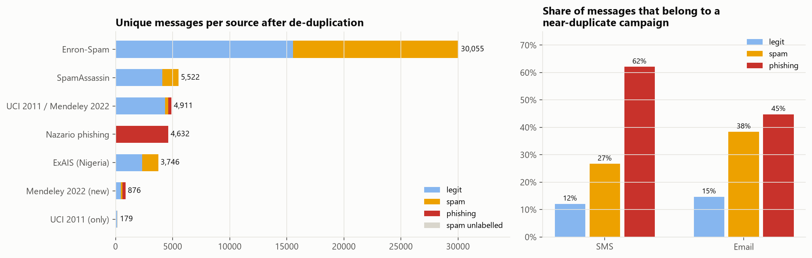

Labels are unified as **legit** (ham, hard ham), **spam** (unwanted marketing) and **phishing** (Mendeley
smishing, all of Nazario). The full audit is in the [data card](../data/README.md); the parts that change the
results are below.

**Copies.** 85% of the Mendeley dataset (4,943 of 5,824 unique messages) is UCI with broken encoding.
Across all sources there are 7,007 exact duplicates, 87 of them labelled differently.

**Campaigns.** MinHash clustering (5-character shingles, digits masked, Jaccard ≥ 0.7) puts 62% of SMS
phishing and 45% of email phishing in a near-duplicate cluster, against 12-15% of legitimate messages.
Train, validation and test (~70/15/15) are split by cluster with `StratifiedGroupKFold`.

**Future test.** All Nazario phishing from 2023-2025 (1,192 emails, 1,153 from campaigns with no older
relative) is held out from the evaluated models.

**Left out.** One Nazario mailbox that Windows Defender quarantines for live malware; 152 non-English emails
(there is no non-English legitimate email, so they would teach "non-English = phishing").

## 2. How much does leakage matter?

TF-IDF + logistic regression, UCI + Mendeley SMS, scam vs legit:

| Protocol | F1 |
|---|---:|
| Concatenate both datasets, random split (3 seeds) | 0.993 ± 0.006 |
| Exact de-duplication, random split (3 seeds) | 0.970 ± 0.011 |

Under the naive protocol, 78% of test messages have an exact copy in training.

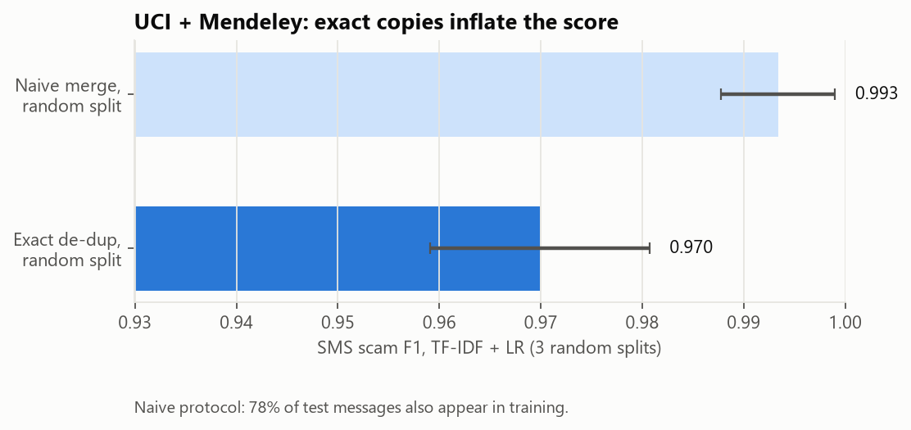

## 3. The shortcut audit

Nazario is 100% phishing; Enron and SpamAssassin legitimate mail is 100% legit. Anything that identifies the
corpus therefore predicts the label. I found three such fingerprints:

- Enron-Spam was packaged lower-cased with a space around every punctuation mark
  (`http : / / www . removeyou . com`, `it ' s`).
- `jose@monkey.org`, the inbox Nazario collected from, appears in 26% of its emails.
- SpamAssassin's legitimate mail is mostly tech mailing lists (list tags, footers).

**The test:** train legit-vs-phishing on Enron legit + Nazario only, then score SpamAssassin legitimate mail,
which the model never saw. A model that learned "looks like Enron = legit" will flag it.

| Text the model sees | Enron legit flagged (seen source) | SpamAssassin legit flagged (unseen) | Phishing caught |
|---|---:|---:|---:|
| As downloaded | 0.0% | **94.7%** | 99.0% |
| Enron packaging undone | 0.0% | 51.6% | 98.6% |
| + addresses, names, list footers, years scrubbed | 0.5% | **15.3%** | 96.7% |

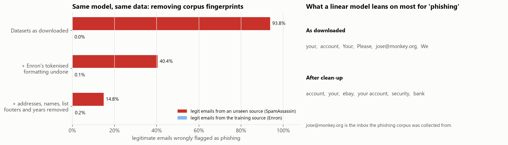

On the usual held-out test the raw model looks perfect. Its strongest phishing feature was the collector's
email address. After scrubbing, the strongest features are *account, ebay, security, bank* and links. The
remaining 15% is a genuine topic gap (Enron was an energy company, so "gas" and "energy" stay legitimate
signals) and is the main reason real-world false alarms remain a limitation.

## 4. Datasets disagree on what spam is

ExAIS labels carrier service notices ("your data plan has expired", "your request is being processed"),
Facebook birthday alerts and motivational-quote subscriptions as spam, while some prize-draw promotions are
labelled ham. I first kept it in training, because a TF-IDF ablation showed it improved the cleanly labelled
SMS test. Handwritten probes then showed the cost: trained on ExAIS, a TF-IDF model scored a one-time-passcode
text at 68% scam (18% without it). On the final split the ablation also turned against it:

| TF-IDF + LR trained… | UCI/Mendeley SMS macro-F1 | false alarms | scams caught |
|---|---:|---:|---:|
| without ExAIS (protocol) | **0.848** | **0.14%** | 90.9% |
| with ExAIS added | 0.827 | 0.71% | 92.3% |

ExAIS is now an external test only. Scored on it, the transformer flags 33% of its "legitimate" messages and
catches 64% of its "spam" (macro-F1 0.62): a measure of how much the label definition differs, not a target.

## 5. Models

All models get the same `prepare()` text: obfuscation undone, emails scrubbed as above, links, phone numbers,
addresses, amounts and years tagged, and a channel prefix (`[sms]`, `[email]`).

| Model | Notes |
|---|---|
| Naive Bayes | My original notebook: stemming, TF-IDF (3,000 terms), chi-squared top 1,000, Bernoulli NB |
| TF-IDF + LR | Word 1-2-grams and character 2-5-grams, class-balanced logistic regression |
| DistilRoBERTa | `distilroberta-base`, 3 epochs, sqrt class weights, channel-balanced sampling, obfuscation augmentation, temperature scaling; 3 seeds on a Colab T4 |

The scam decision is made first (P(spam) + P(phishing) ≥ 0.5), then the type. Early stopping uses the mean of
SMS and email validation macro-F1, so the 4x larger email set can't hide an SMS regression.

## 6. Results

Campaign-held-out test: 845 SMS (UCI/Mendeley) and 5,574 emails. DistilRoBERTa: mean ± std over 3 seeds.

| | Naive Bayes | TF-IDF + LR | DistilRoBERTa |
|---|---:|---:|---:|
| **SMS** macro-F1 (95% CI) | 0.448 | 0.848 (0.797-0.892) | **0.857** ± 0.020 (0.814-0.909) |
| SMS scam F1 | 0.247 | 0.949 | **0.968** |
| SMS scams caught | 14.1% | 90.9% | **94.8%** |
| SMS legitimate flagged | 0.00% | **0.14%** | 0.23% |
| **Email** macro-F1 (95% CI) | 0.891 | 0.967 (0.960-0.973) | **0.969** ± 0.004 (0.968-0.979) |
| Email scams caught | 90.6% | **98.8%** | 98.0% |
| Email legitimate flagged | 6.2% | 1.46% | **0.73%** |
| Calibration error (ECE), SMS / email | 0.141 / 0.060 | 0.018 / 0.013 | **0.004 / 0.008** |

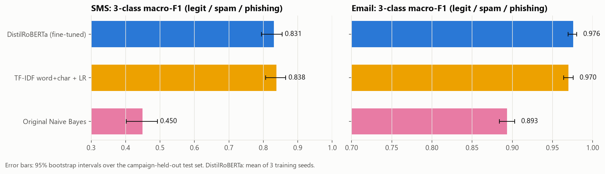
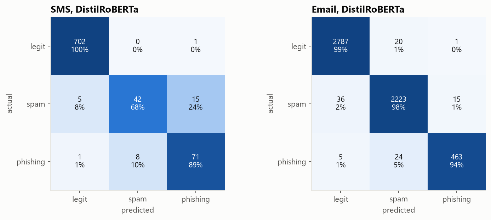
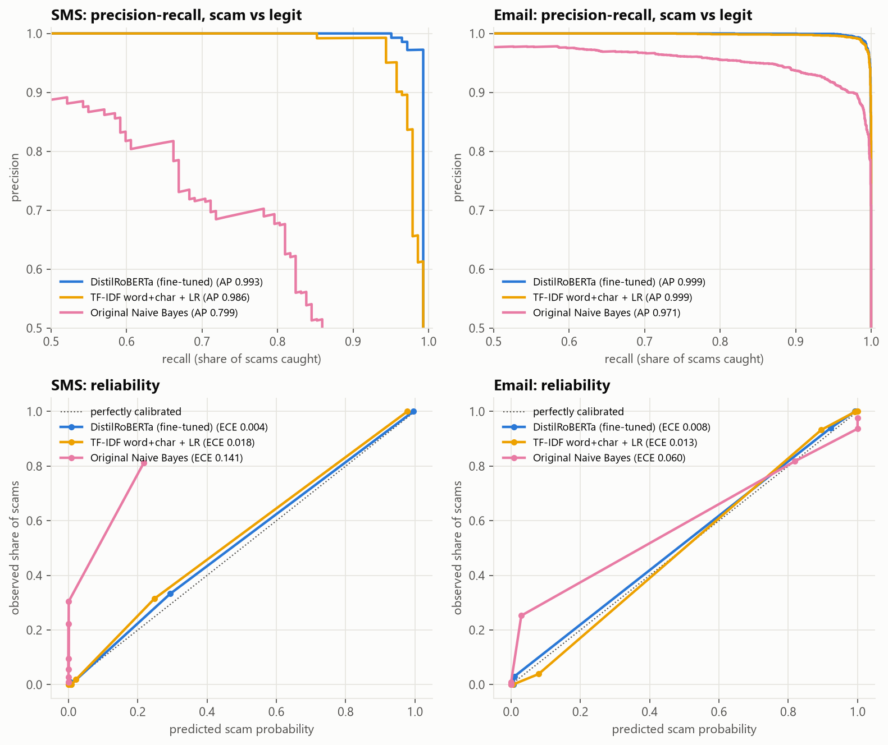

- **On clean text, TF-IDF is within the transformer's confidence interval.** The transformer's advantages
  are fewer email false alarms (half), more SMS scams caught, calibration, and robustness (section 8).
- **Most SMS errors are spam vs phishing.** Telling scams from legitimate texts scores F1 0.968; deciding
  which kind of scam is harder, partly because the labels disagree: "500 FREE text messages, reply FREE" is
  labelled phishing, near-identical prize texts are labelled spam.
- **Naive Bayes collapses on SMS** when trained with email: its 1,000 shared terms are chosen by email, so
  it calls 86% of SMS scams legitimate. In 2024, trained on SMS alone, the same pipeline scored 0.91.
- **Seeds matter.** SMS macro-F1 ranges from 0.830 to 0.877 across three seeds; a single-run comparison
  between close models would be noise.

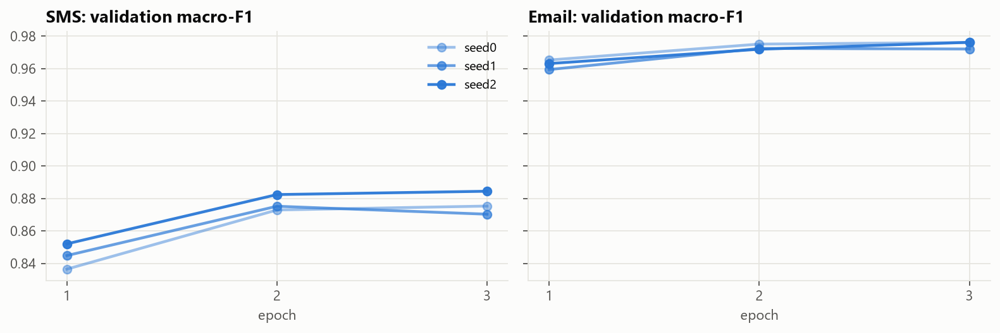

## 7. Phishing written after the training data

| | Naive Bayes | TF-IDF + LR | DistilRoBERTa |
|---|---:|---:|---:|
| Test phishing, 2005-2007 | 94.9% | 98.3% | 99.4% |
| Test phishing, 2015-2022 | 87.9% | 99.2% | 99.0% |
| **Future: 2023** | 90.8% | 97.9% | 96.6% |
| **Future: 2024** | 83.7% | 92.9% | 94.4% |
| **Future: 2025** | 83.1% | 94.8% | 94.4% |
| Future, campaigns with no older relative: phishing recall | 77.6% | 88.8% | **90.3%** |

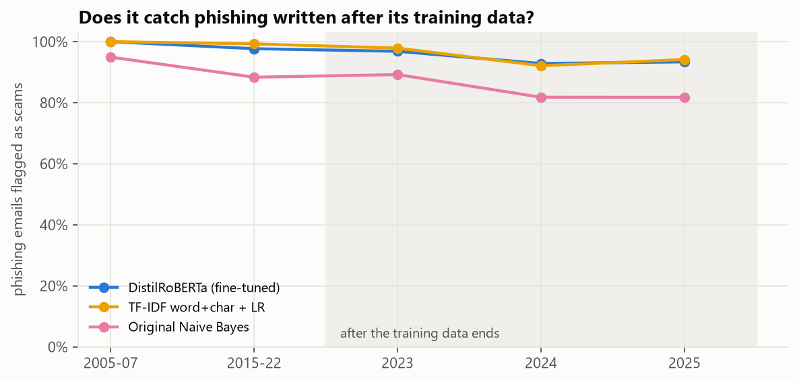

Detection drops by about 5 points once the data is newer than the training set, then holds steady from 2024
to 2025. The DistilRoBERTa seeds agree within ±1.4 points.

## 8. Robustness to obfuscation

Four character-level attacks (leetspeak `fr33`, Cyrillic look-alikes, spacing `f.r.e.e`, adjacent-letter
typos) and a mix, applied to a growing share of words in validation scams.

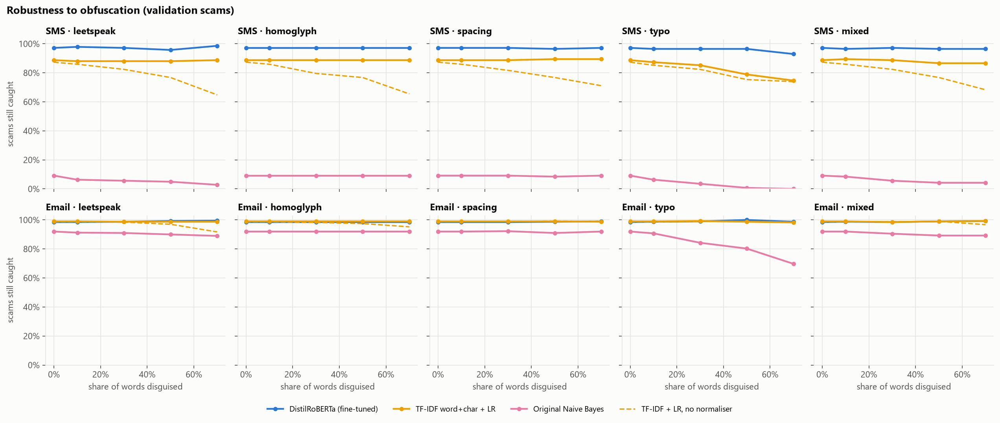

- The **normaliser** does most of the work: the same TF-IDF model without it drops from 87% to 65% of SMS
  scams caught at 70% leetspeak; with it, it stays at 89%.
- **Typos** can't be normalised away. At 70% typos, TF-IDF catches 75% of SMS scams; the deployed transformer,
  trained on augmented copies, still catches 93%.
- (The deployed transformer was also trained on the test split, so its robustness is measured on validation
  messages, like the baselines.)

## 9. SMS vs email

| Trained on → tested on | TF-IDF SMS | TF-IDF email | DistilRoBERTa SMS | DistilRoBERTa email |
|---|---:|---:|---:|---:|
| SMS only | **0.893** | 0.399 | 0.838 | 0.305 |
| Email only | 0.397 | **0.969** | 0.471 | 0.942 |
| Both | 0.848 | 0.967 | **0.865** | **0.974** |

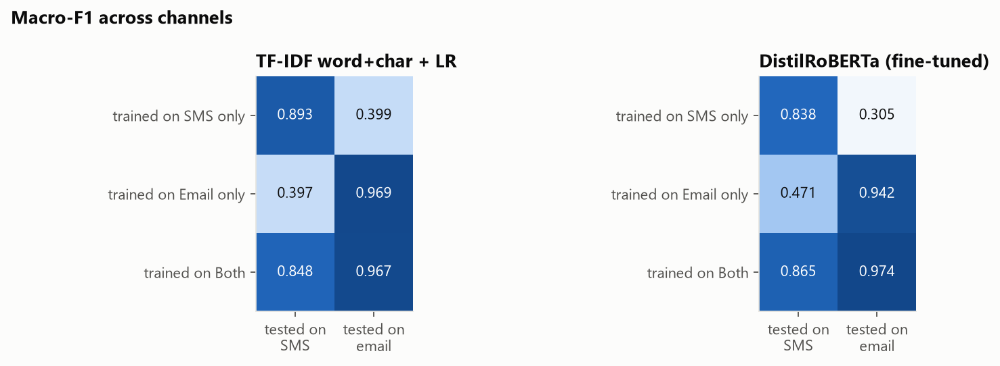

The channels barely transfer. Training on both costs TF-IDF 4.4 points on SMS (email dominates its
vocabulary) but helps the transformer on both channels. (Single-channel transformer runs: one seed each.)

## 10. Scams without a hook

How many test scams contain none of a link, phone number, email address or money amount, and how many of
those are caught:

| | SMS (28 such scams) | Email (902) |
|---|---:|---:|
| Naive Bayes | 14% | 80% |
| TF-IDF + LR | 75% | 98% |
| DistilRoBERTa | **83%** | **97%** |

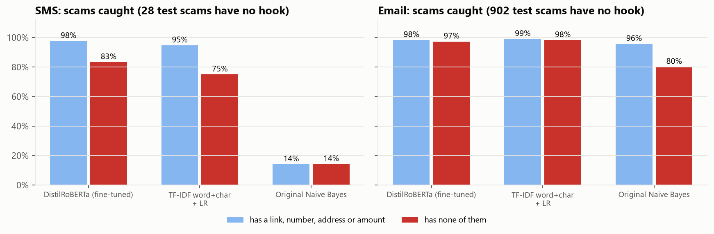

With only 28 hook-free SMS scams in the test set this is indicative only, but the gap to scams with a hook
(98% for the transformer) is consistent across models.

## 11. Error analysis

On the campaign-held-out test, the transformer (seed 0) misses 6 SMS scams and 41 email scams, and raises
1 SMS and 21 email false alarms. Reading them:

- **Missed SMS** are mostly old-style subscription and quiz spam with no call to action left
  ("For sale - arsenal dartboard. Good condition…", a Simpsons trivia question).
- **Several email errors are label errors in the source data.** A Nazario "phishing" email reads "DON'T DELETE
  THIS MESSAGE -- FOLDER INTERNAL DATA": a mail client's housekeeping message, not phishing. Enron "legitimate"
  mail includes newsletters ("digitize your memories with compaq scanners", "welcome to the next wave in digital
  music") that the model calls spam.
- **Missed email phishing** includes attachment-only lures ("SHIPPING DOCUMENT: please find attached the
  commercial invoice") where the scam is in a file the model never sees.

**Handwritten probes** (illustrative, not a benchmark): current UK scams with a link or money are caught at
over 99% (HMRC refund, Netflix billing, parcel fee, crypto withdrawal, a CEO gift-card request with no link).
But genuine one-time-code, parcel-delivery and bank-card-alert texts are flagged as phishing, as is a genuine
Amazon shipping email, and "Hi mum, new number, can you send £200" scores 2.5%.

## 12. Deployment

| | PyTorch fp32 | ONNX int8 |
|---|---:|---:|
| Size | 328.5 MB | 82.5 MB |
| Same decision as PyTorch (6,418 validation messages) | | 99.6% |
| Median probability difference | | 0.0005 |

Hugging Face now charges for server-backed Spaces, so the demo is a static page: it downloads the int8 model
once (cached) and runs it with ONNX Runtime Web. Preprocessing, the decision rule and the occlusion
explanations are ported to JavaScript and checked against Python by a Node test suite on 249 messages (SMS and
email, attacked variants and edge cases): identical text preparation and token IDs, identical labels except
on near-boundary messages, and the same strong explanation words. A check takes about 1 s for an SMS and 4-6 s
for an email, explanation included, on a laptop.

The deployed model was retrained on train + test + future (validation kept for early stopping and the
temperature), so the numbers above describe the protocol rather than that exact checkpoint. On validation it
scores 0.859 (SMS) and 0.965 (email) macro-F1.

## 13. Limitations and next steps

1. **Legitimate service messages.** The biggest practical gap. Codes, delivery updates and bank alerts look
   like phishing to the model because the training data has scams imitating them but almost none of the real
   ones. Next step: collect and label a few hundred real service messages (my own inbox, with consent from
   others) and add them as a training source and a dedicated test.
2. **Modern legitimate email.** All legitimate email is from 1999-2005; modern brand notifications only
   appear as phishing. Same remedy.
3. **Social-engineering scams** with no link, number or money ("Hi mum") are rare in the data and missed.
4. **Label noise** at the spam/phishing boundary and in the source corpora (section 11). Relabelling the
   conflicting campaigns would likely help more than any model change.
5. **Single-channel transformer runs** used one seed; the main comparison used three.
6. **English only.**

## Reproducing

Every number and figure comes from `reports/results.json`, `reports/data_audit.json` and
`reports/shortcut_audit.json`, regenerated by the commands in the [README](../README.md#reproduce-it).
Transformer training runs on a free Colab T4 from `notebooks/train_on_colab.ipynb` (about 90 minutes for all
six runs); everything else runs on a laptop CPU.
